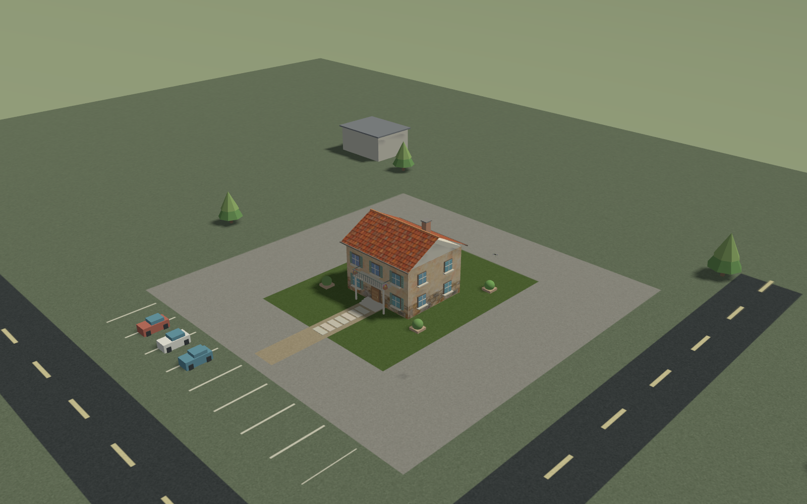
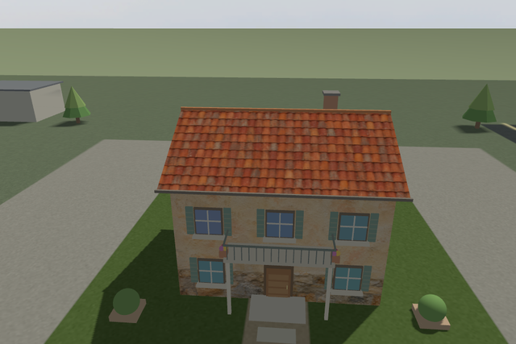
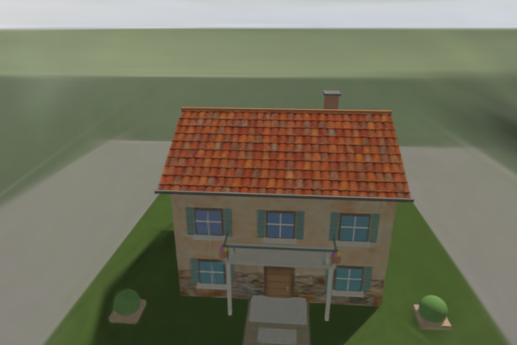

# 3D ev — gerçek kamera ve Gaussian karşılaştırması

Taş/sıva cephe, kiremit çatı, panjur, pencere çerçeveleri, balkon ve bahçe gerçek 3D geometri/malzemelerdir.

| Gerçek hold-out RGB | Modelin aynı bakıştan render'ı |
| --- | --- |
|  |  |

AUTO görevi evi iki yükseklikte dolaşır; ROI kamerayı eve yönlendirir ve mesafeli trigger fotoğraf toplar. 108 fotoğrafın 94'ü eğitim, 14'ü hold-out içindir. Hold-out fotoğraflar initialization'da da kullanılmaz. Kamera pozları Gazebo'dan bilinir; ev mesh'i eğitimde okunmaz.

[Metrikler](metrikler.json) · [Eğitilmiş PLY](../Bina-Gaussian.ply) · [Ders kodu](../../simulasyon/ders_kodlari/haritalama_3d.py)

Model görünüş üretir; ölçülmüş bir triangle mesh değildir. Pencere, ince korkuluk ve örtülen yüzeylerde artefact kalabilir. Viewer'da yeni açılara geçerek bunları inceleyin.
