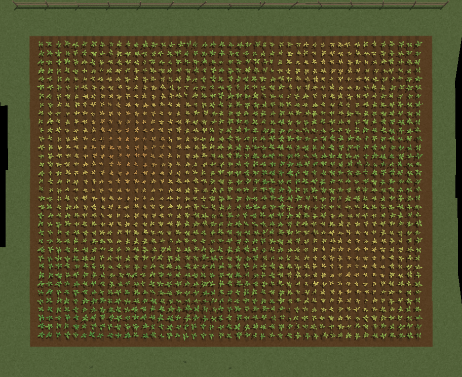

# Renk ve boy çeşitliliği olan tarla — gerçek RGB mozaik

**4 Kasım 2026** tarihinde güncel Gazebo dünyasında AUTO görev uçuruldu.
81 kamera tetiği, 81 gerçek RGB fotoğrafı ile eşleşti. Görev LAND ve disarm ile
bitti; uçuş boyunca yalnız AUTO kullanıldı ve Python uçuş setpointi göndermedi.

1 575 bitkinin renk, boyut ve yaprak yönü farklıdır. Bölgesel sararma yumuşak
geçişlidir; aynı seed sahneyi tekrarlanabilir yapar. RGB'de stres haritasını
andıran dağılım, gerçek 3D bitkilerin görünüşünden gelir. Bu bir **sentetik senaryo**;
NDVI veya ölçülmüş tarımsal stres haritası değildir.

- [Gazebo kamera görünüşü](Gazebo-Tarla.png)
- [En merkezi bakışlardan RGB mozaik](Tarla-RGB-Mozaik.png)
- [Ağırlıklı ortalama ile karşılaştırma](Tarla-Ortalama-Mozaik.png)
- [Görüntü örtüşme sayısı](Goruntu-Ortusmesi.png)
- [Metrikler](metrikler.json)
- [Çalışan ders kodu](../../simulasyon/ders_kodlari/haritalama_2d.py)

Çıktı 912×744 piksel; kapsama %100, en az üç görüntülü alan %99,32.
Kod bilinen kamera pozlarıyla z=0 projeksiyonu yapar; bitki yüksekliği nedeniyle
parallax/dikiş görülebilir. Kaynak tarla dokusu ve senaryo stres değerleri
algoritmaya verilmez. Ortalama mozaikteki çift yaprak etkisini azaltmak için
ana çıktıda her pikselin en merkezi bakışı seçilir; renkler değiştirilmez.
